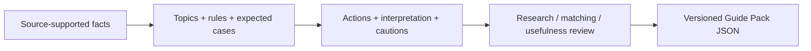

# Improve a Guide Pack

Choose a quality goal, change the responsible extension point, then assess the result. A contribution can improve one area without establishing quality in the other two.

| Goal | Extension point | Where to change it | How to assess it |
| --- | --- | --- | --- |
| Research better | Discovery, extraction and encoding | [prompts/research.md](prompts/research.md) | Compare output with a fixed source sample; record unsupported claims, omissions and date errors. |
| Research better | Facts and provenance | `profiles/`, `startups/`, `catalog.json` | Check claim/source agreement, historical dates, unknowns and limitations. |
| Research better | Review practices | [prompts/review.md](prompts/review.md), review register and source notices | Record what was reviewed, by whom, disagreements and unresolved rights. |
| Match better | Investor topics and context conditions | `components/matching.json`; [prompts/matching.md](prompts/matching.md) | Establish expected matches, nonmatches and unknown-context cases before running them. |
| Match better | Compatibility, operators and evidence merging | Startup Guide: `js/context.js`, `js/matching.js` | App behavioral and regression tests; new operators require app and format work. |
| Suggest better | Action content and reasoning | `components/suggestions.json`; [prompts/suggestions.md](prompts/suggestions.md) | Review clarity, effort, relevance, cautions and observable learning; obtain actual founder feedback. |
| Suggest better | Prioritization, fallback copy and presentation | Startup Guide: `js/recommendation.js`, `js/explanations.js`, `js/ui.js` | Check representative priority conflicts, fallback explanations and real interface usability. |
| Assess quality better | Separate review methods and honest reporting | [prompts/review.md](prompts/review.md), package quality declarations | Report actual samples, results and limits; a declaration does not perform a review. |

**Pack extension points** use the supported JSON contract. **App extension points** change JavaScript and require app tests. Guide Packs cannot execute provider code or replace the matching engine.

## Small stages, explicit handoffs

[AUTHORING_PROMPT.md](AUTHORING_PROMPT.md) coordinates the focused stages. Each stage states its inputs and outputs; review can send unresolved work back. Use [PACK_FORMAT.md](PACK_FORMAT.md) and `schema/` for exact fields, values and limits. Avoid copying the format contract into prompt modules.

## Worked contribution: make an action clearer

Use [the fictional demo](examples/demo-guide-pack.json) to practice; its records and relationships are invented.

| Step | Concrete example |
| --- | --- |
| Inspect evidence | Snapshot `demo_tools_reservations` describes an illustrative tool-reservation approach; profile `demo_discovery` carries the fictional `customer_learning` topic. |
| Inspect connection | Rule `rule_demo_tools_reservations_0` connects the supported marketplace context and demand question to `bounded-reservation-test`. |
| Improve the action | Clarify the suggestion's `approach`: identify the uncertainty, bound the attempt and describe what to record. Keep evidence and cautions intact; do not invent historical results. |
| Check matching | The `demand_match` case should still return the same suggestion ID. Retain mismatch, unknown-stage and missing-topic cases; wording alone should not widen eligibility. |
| Check usefulness | Ask actual reviewers whether they understand what to do and what they could learn. Record their feedback or explicitly report that user evaluation has not occurred. |
| Deliver | Review changed bytes, update applicable notices and declarations, increase the package version and assemble the complete JSON. Preview it in the app and report actual results. |

The app can offer startup-only suggestions from compatible researched lessons. The real Research Guide Pack currently lacks investor-topic connections. Do not transfer the fictional connection into research or invent a real priority to obtain positive tests.

## Review and submit

- Change the smallest responsible extension point. If a matching result is wrong, inspect the fact, rule, expectation and algorithm before choosing which one to edit.
- Follow the [review stage](prompts/review.md) for changed distributable records/components and their exact-byte hashes. Update `SOURCES.md` and applicable notices; preserve unresolved facts as unknown or omit unresolved additions.
- Follow the [packaging stage](prompts/package.md) for changed JSON. Preserve stable identities, increase its version and report checks honestly. Documentation/prompt-only changes need no manufactured record review or JSON version bump.
- In a proposed contribution, explain the problem, responsible files, evidence, expected behavior, actual checks and remaining limitations. Supply source references and preserve required attribution.
- For app changes, use [Startup Guide's development guide](https://github.com/hmc62843u/startup-guide/blob/main/DEVELOPMENT.md#extension-points-and-contracts) extension contracts and regression checks. Pack tests measure candidate agreement; app tests check software behavior. Neither certifies source truth or founder outcomes.

Commit, submit or publish only within the contributor's authorization. No automatic publication or independent certification is implied by following this guide.
