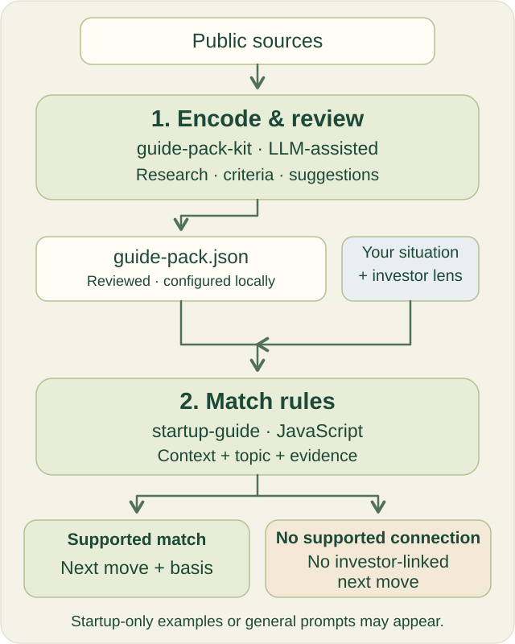

# Methodology and quality

**Encoding defines supported connections. Matching checks when they apply.**

This reference and illustration retain their [original MIT licence](APP_DOCS_LICENSE.md). Research records keep their separate terms.

## Two stages

| Stage | Who does it? | Result |
| --- | --- | --- |
| Encode and review | A contributor, with an LLM or another assistant | Dated facts, sources, topics, rules and proposed experiments in a complete Guide Pack |
| Apply rules | Startup Guide's JavaScript | A relevant move and its evidence status for the user's situation and chosen investor |

The browser uses one configured local pack. It makes no LLM calls, searches or automatic research updates. A script wrapper makes the complete JSON data readable on direct-file URLs; it does not replace the app's engine. [Authoring guide](GUIDE_PACKS.md) · [Local setup](LOCAL_APP.md).

## What connects

A complete connection requires a lesson matching the business model, startup stage and question; a comparable selected profile passing the known stage/sector checks; an explicitly encoded investor topic matching the lesson; and valid references to known snapshot facts and sources. Unknown facts are not inferred. A reference-only profile cannot support a connection.

| Evidence available | What the app shows |
| --- | --- |
| Investor topic and startup lesson connect | A sourced interpretation to consider; no endorsement implied |
| Compatible startup lesson only | A startup-only example that can be adapted |
| Relevant investor topic only | An investor perspective beside a general exercise |
| Neither | A general exercise without supporting library evidence |

A raw snapshot without an authored context rule is browsable, but not automatically a relevant suggestion. With no investor selected, a complete connection can be previewed but requires explicit selection before adaptation. Sources and limits stay available on demand. Browsing other records does not change the move.

## One example

| | Fictional pack | Research pack |
| --- | --- | --- |
| Startup approach | Tool reservations in an invented scenario | DoorDash's dated local-service launch account |
| Investor topic | Discovery Fund's invented customer-learning interest | firstminute has stage/sector facts but no encoded customer-learning topic |
| Result | A fictional complete connection in the supported context | A startup-only local-service example; no documented firstminute alignment |

A connection is an authored interpretation of relevance. It does not establish that the investor funded the startup, that the approach caused survival, or that a founder will receive funding. Observed facts, suggested experiments and self-reported learning remain distinct.

## How to assess quality

**Research quality → matching quality → suggestion quality.** Each requires its own checks.

| Quality | Check | Report |
| --- | --- | --- |
| Research | Review claims against sources, historical dates, omissions and unknowns; examine reuse bases | Supported/unsupported claims, unresolved issues, sample size and reviewer agreement |
| Matching | Establish expected matches, nonmatches, boundaries and insufficient-information cases before execution | False matches, missed valid matches, case selection, package/app versions and actual agreement |
| Suggestions | Ask founders whether the action is clear, relevant and feasible; inspect what the experiment taught them | Feedback and learning value, with unperformed evaluation marked explicitly |

LLM-assisted encoding can vary and contain errors. Deterministic rules can repeat errors caused by bugs, incomplete criteria or bad research. Repeatable does not mean correct. A good score at one stage does not establish quality at the next, and neither stage guarantees startup success.

Provider self-tests check the candidate matcher, not source truth, next-move prioritization, saved progress or founder outcomes. Four passing no-match cases in the current researched pack do not demonstrate positive coverage. Provider identity and quality declarations are not authenticated or independently certified.

Use [CONTRIBUTING.md](CONTRIBUTING.md) for extension points and [prompts/review.md](prompts/review.md) for review handoffs. Executable matching, prioritization and interface changes belong in [Startup Guide](https://github.com/hmc62843u/startup-guide/blob/main/DEVELOPMENT.md#extension-points-and-contracts); supported declarative criteria and experiment content belong in this Kit.
